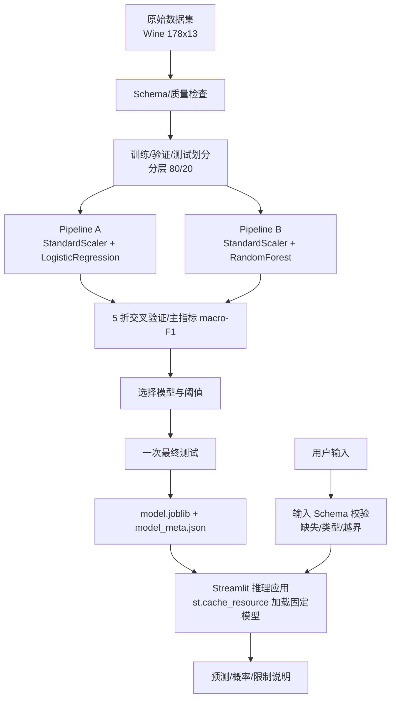

# Wine 葡萄酒品种智能分类系统

一句话简介：基于 scikit-learn + Streamlit 的机器学习智能分类应用，训练并比较两种算法，把最佳 Pipeline 封装成可交互 Web 界面，对葡萄酒化学指标实时预测品种。

## 目标用户、问题场景与功能清单

- **目标用户**：对葡萄酒成分有数据但需要自动鉴别品种的品酒师/实验人员；学习机器学习工程化的学生。
- **问题场景**：传统机器学习实验停留在 Notebook，模型分数无法被普通用户稳定调用，也无法说明输入字段、预处理和模型版本是否一致。本应用把数据校验、训练、评价、模型保存与在线推理解耦。
- **功能清单**：
  - 单条实时预测：表单输入 13 项化学指标，校验后预测品种并显示概率
  - 双算法比较：Logistic Regression vs Random Forest，5 折分层交叉验证同协议对比
  - 指标报告：Accuracy / macro-Precision / macro-Recall / macro-F1 / 混淆矩阵
  - 自主功能①：**可调分类阈值**，展示目标类别 Precision/Recall/F1 随阈值变化
  - 自主功能②：**批量 CSV 预测**，逐行校验、坏行隔离、结果下载
  - 自主功能③：**输入越界（OOD）提示**，超出训练数据实际范围给出警告

## 技术栈与系统架构

| 组件 | 技术 | 版本 |
|---|---|---|
| 训练与 Pipeline | scikit-learn | 1.7.2 |
| 数据处理 | pandas / NumPy | 2.3.3 / 2.5.3 |
| 推理界面 | Streamlit | 1.50.0 |
| 模型保存 | joblib | 1.6.0 |
| 测试 | pytest | 9.1.1 |



## 环境要求与版本检查命令

- 操作系统：Windows / Linux / macOS（受支持版本）
- Git ≥ 2.40
- Python 3.13（本机实测；scikit-learn 1.7.2 自 1.7.0 起支持 Python 3.13，官方推荐 3.11/3.12 亦可）
- 普通 CPU 即可，不依赖 GPU、Jupyter 或收费 API

```bash
python --version
git --version
.\.venv\Scripts\python.exe -c "import sklearn, streamlit, pandas; print(sklearn.__version__, streamlit.__version__, pandas.__version__)"
```

## 安装、配置、初始化、运行和停止

```bash
# 1. 创建虚拟环境（建议 Python 3.13）
python -m venv .venv

# 2. 安装依赖（与实验锁定版本一致）
.\.venv\Scripts\pip install -r requirements.txt

# 3. 训练并保存模型（生成 models/model.joblib、model_meta.json、threshold_data.json）
.\.venv\Scripts\python.exe -m src.train

# 4. 运行 Web 应用
.\scripts\start.ps1        # 或 .\.venv\Scripts\streamlit.exe run app.py

# 5. 停止
.\scripts\stop.ps1
```

一键脚本：`.\scripts\start.ps1` 启动并打开浏览器，`.\scripts\stop.ps1` 结束进程。

## 最小演示数据与完整 Demo 流程

内置 `sklearn.datasets.load_wine`（178 样本、13 特征、3 类，无需联网下载）。

1. 启动应用，打开「单条预测」页签；
2. 使用 Wine 数据集第 1 行作为合法输入（见 `tests/conftest.py` 的 `valid_row`）提交预测，核对预测类别与概率；
3. 将某特征值改为远超训练范围（如 proline=99999）再提交，观察 OOD 警告；
4. 打开「阈值分析」页签，拖动阈值滑杆，观察 Precision/Recall 变化；
5. 打开「批量预测」页签，上传 `data/sample_input.csv`，下载预测结果。

## 测试方法、测试结果与已知问题

```bash
.\.venv\Scripts\python.exe -m pytest
```

**结果：23 passed（2026-10-08 实测）**。覆盖实验要求的全部测试类型：

| 测试类型 | 数量 | 重点 |
|---|---|---|
| 数据/划分测试 | 5 | Schema、分层、可复现、无泄漏 |
| 模型评价 | 2 | 双算法同协议、最终测试集仅评价一次 |
| Pipeline 测试 | 6 | 原始输入可预测、保存/加载一致、未知列/缺失/非数值拒绝、列顺序无关、SHA256 |
| 应用测试 | 6 | 合法/非法/越界/批量输入，提示清楚 |
| 自主功能测试 | 3 | 阈值调整量化证据 |

- 已保存证据：`docs/model_comparison.json`（双模型同协议评价）、`docs/final_evaluation.json`（最终测试集运行记录）、模型文件与元数据 SHA256 对照。
- 已知问题/限制：
  - 模型概率未经校准（calibration），不代表事实确定性，界面已展示限制说明；
  - 分布外输入（OOD）目前仅提示，不自动拒绝，极端新分布下建议重训；
  - joblib 反序列化依赖 scikit-learn 1.7.2，跨主版本需在相同环境重训。

## 二次开发内容（与上游基线的差异）

本实验不 Fork scikit-learn / Streamlit 两个大型库，而是**创建独立应用仓库、依赖固定版本**。学生本人实现的部分：

- 任务定义：Wine 三分类任务、样本单位（一瓶酒的 13 项化学指标）、主指标（macro-F1）与划分策略
- `src/features.py`：特征 Schema 与表单范围
- `src/validate.py`：输入校验（缺失/类型/未知列/越界）
- `src/train.py`：双算法 Pipeline、5 折交叉验证比较、模型选择、元数据（SHA256/Git Commit/版本）保存
- `app.py`：Streamlit 推理界面 + 三个自主功能（阈值调整、批量预测、OOD 提示）
- `tests/`：22+ 个可重复测试用例
- 模型卡、README、NOTICE 与许可证管理

## 个人开发记录及贡献证据

- 提交记录：至少 5 个可解释 Commit（基线 → 训练 → 应用 → 自主功能 → 测试/文档），见 `git log --oneline`
- 分支策略：feature 分支开发 + 合并记录，配合自我 Code Review（见 `docs/self-review.md`）
- 测试证据：`pytest -q` 23 passed 运行记录
- 评价证据：交叉验证对比表、最终测试集混淆矩阵

## 上游项目、第三方资源来源及 License

| 资源 | 来源 | 许可证 |
|---|---|---|
| scikit-learn 源码 | https://github.com/scikit-learn/scikit-learn（实测 1.7.2） | BSD-3-Clause |
| Streamlit 源码 | https://github.com/streamlit/streamlit（实测 1.50.0） | Apache-2.0 |
| Wine 数据 | https://archive.ics.uci.edu/dataset/109/wine | CC BY 4.0（按 UCI 页面记录） |
| Pipeline 文档 | https://scikit-learn.org/stable/modules/compose.html | — |
| Streamlit 表单文档 | https://docs.streamlit.io/develop/concepts/architecture/forms | — |

开源库许可证不替代数据许可证。第三方来源清单详见 `NOTICE.md`。

## 安全注意事项与敏感配置处理

- 仓库不含任何密码、Token 或数据库口令；本应用无外部网络依赖、无密钥。
- joblib/pickle 可加载可执行代码：应用**只加载本人训练并校验过的 `models/model.joblib`**（SHA256 记录在元数据），绝不接收用户上传的任意模型文件。
- 批量上传仅做内存内解析与预测，不落盘、不执行用户内容。

## 主要功能截图

（演示时补充：单条预测结果页、阈值曲线页、批量预测下载页，建议配合 `docs/screenshots/` 目录）

## 本实验追加说明

- **训练命令**：`python -m src.train`；**推理命令**：`streamlit run app.py`
- **数据获取**：`from sklearn.datasets import load_wine`（内置，无网络依赖）；原始来源 UCI，CC BY 4.0
- **划分策略**：分层 `train_test_split`（80/20，random_state=42）；交叉验证 `StratifiedKFold`（5 折，shuffle，seed=42）；无重复主体，不存在分组泄漏
- **主指标**：macro-F1（平等看待三个类别）
- **模型文件来源**：`models/model.joblib`（本人训练），SHA256 见 `model_meta.json`
- **Schema**：13 个数值特征，顺序见 `src/features.py`，与表单/批量输入一致
- **重新训练条件**：数据分布变化（OOD 频发）、依赖版本升级或需要跨模型比较时，在相同环境下重跑训练命令
